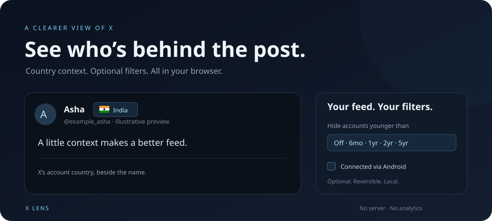

<div align="center">

# X Lens

**See the context behind the account.**

Country names and flags beside X accounts. A quieter feed, on your terms.

[Install from GitHub](#install-from-github) · [How it works](#how-it-works) · [Privacy](#privacy) · [Development](#development)



*Illustrative preview. Names and post content are fictional.*

</div>

## A little more context

X Lens puts the country from X’s **About this account** page beside the author’s name. It also adds two optional filters. Country labels are on by default. Both account filters and all distraction switches are off.

| Feature | What you get |
| --- | --- |
| **Country + flag** | X’s “Account based in” field beside names in posts, replies, and quotes. |
| **Account age** | Hide posts from accounts younger than **6 months, 1 year, 2 years, or 5 years**. |
| **Bio keywords** | Hide posts when a profile bio contains any comma-separated word or phrase. Ignore case. |
| **Connection filters** | Separately hide Android, iOS / App Store, or Web accounts using X’s “Connected via” field. |
| **Hide distractions** | Separate switches for For you, Today’s News, and What’s happening. |
| **Show post** | Reveal any filtered post. Quotes can be filtered separately. |
| **Automatic country lookups** | Load details for nearby posts, with shared caching and paced requests. |
| **Local cache** | Reuse saved details for one year (365 days) without repeated lookups. |

## Install from GitHub

**Chrome desktop 111 or later. No Node.js, terminal, or build step required.**

1. **[Download X Lens](https://github.com/prakash09/x-lens/archive/refs/heads/main.zip)** as a ZIP. You can also use **Code → Download ZIP** on this repository.
2. Extract the ZIP to a folder you will keep. The extracted folder is usually named `x-lens-main`.
3. Open a new Chrome tab and enter `chrome://extensions` in the address bar.
4. Turn on **Developer mode** in the top right.
5. Click **Load unpacked**. Select the extracted folder that contains `manifest.json`. Do not select the ZIP or its parent folder.
6. Open [X](https://x.com/home), sign in, and refresh the page. Use **Account filters** at the bottom left, or pin **X Lens** from Chrome’s Extensions menu.

GitHub distributes the files. Chrome loads them as an unpacked extension. This project is not currently published in the Chrome Web Store. These steps follow [Chrome’s official unpacked-extension guide](https://developer.chrome.com/docs/extensions/get-started/tutorial/hello-world#load-unpacked).

<details>
<summary><strong>Prefer Git?</strong></summary>

```sh
git clone https://github.com/prakash09/x-lens.git
```

Load the `x-lens` folder in Chrome with the same steps above. The generated bundles are committed, so a build is not needed to install.

</details>

### Update or remove

**Update:** Download the latest ZIP, extract it, and replace the files in your existing extension folder. Keep `manifest.json` at its root. In `chrome://extensions`, click the reload icon on X Lens, then refresh open X tabs. Git users can run `git pull --ff-only` instead of replacing files.

**Remove:** Open `chrome://extensions` and click **Remove** on X Lens.

## Use it your way

- **Hover a country badge** to see the reported country, connection source, and join date. Click the badge to open that account’s About page.
- **Countries load automatically** for accounts near the screen. There is no separate lookup switch. Fresh cached results skip the request.
- **Choose an account age** to hide younger accounts. Choose **Off** to restore them. An account exactly at the cutoff stays visible. Unknown, invalid, or future join dates stay visible.
- **Enable a connection filter** to match that specific field from X. iOS matches iOS, iPhone, iPad and App Store labels. Each filter is independent. The field does not prove the signup device or the device used for the current post.
- **Enter Bio keywords**, for example `venture, co-founder, investor`. Any matching phrase hides the author’s posts. Matches are literal substrings and ignore case. Empty entries are ignored; clear the field to turn it off. Bios come from X’s normal timeline, profile and hover-card responses. This filter does not open profiles or make extra requests. Each new bio response updates matching immediately. Bios are kept only in the current page’s memory and are not saved in the account cache. Unknown bios stay visible.
- **Hide distractions** with three separate switches. Hiding a selected **For you** tab switches Home to **Following**. The sidebar switches hide the **Today’s News** and **What’s happening** cards and preserve other sections. Turn each switch off to restore it. These labels currently match X’s English interface.
- **Click Show post** to reveal a filtered post. Changes apply to open X tabs. These filters do not block or mute accounts.

The country is X’s reported account base. It is not citizenship, the profile’s written location, or a flag in the display name. Broad regions use a neutral globe. A globe alone means a country is not available yet.

## How it works

X Lens reads account metadata from X’s own responses and looks up missing About details automatically for posts on screen and up to two screens ahead. This includes reply and quote authors. It does not request every account in a fetched timeline.

All X tabs share one lookup at a time, with a one-second delay between requests. Repeated authors use the same cached result. The cache holds up to 1,000 accounts for one year (365 days) and survives refreshes. A worker restart retains the request spacing and active-request lease. X rate limits pause requests for at least 15 minutes, or longer if X reports a later reset. There is no hourly account cap imposed by the extension.

Page changes coalesce into one scan per frame. Settings and cached details begin loading at document start. Cached labels can appear as rows render. First-time labels depend on X’s response time, the queue, and request limits.

X Lens uses X’s internal `AboutAccountQuery`, with a fallback query path and discovery from X’s own requests. It reads the session headers from those requests in page memory. No authentication token is included in this repository. X can change or restrict this endpoint.

### If a country does not load

| What you see | What to do |
| --- | --- |
| Waiting for X session headers | Sign in, open an account’s About page, then refresh X. |
| Lookups paused or a rate-limit message | Wait for the pause to expire. Rate limits pause requests for at least 15 minutes; cached details still work. |
| X returned 401, 403, or 404 | Open an account’s About page and refresh X. These errors pause lookups for 5 minutes. |
| Old saved details | Click **Refresh saved account details** in the popup, then refresh X to clear its in-memory cache. |

A failed lookup never makes an account match a filter.

## Privacy

**No external server. No analytics. No account required beyond your X session.**

- Runs only on `x.com` and `twitter.com`.
- Requests only the `storage` extension permission. Its content scripts read and change X pages.
- Sends account lookups only to X through your existing session.
- Keeps settings and projected About details in this browser’s local storage. Profile bios are not saved. Settings load again after tabs or Chrome close.
- Keeps session headers in X’s page context, in memory. They are not stored in the account cache or sent to another service.
- Does not follow, block, mute, like, repost, or publish anything.

X itself can observe page-context code and messages. The extension does not create a security boundary against X.

## Development

Runtime files have no package dependencies. `jsdom` is used only for tests. Validation used Node.js 24.

```sh
npm ci
npm run build
npm run check
npm test
```

| File | Purpose |
| --- | --- |
| `model.js` | Account parsing, country flags, calendar cutoffs, and settings migration. |
| `page.js` | Read X responses, capture request headers, and pace optional lookups. |
| `page.bundle.js`, `content.bundle.js` | Generated bundles for both execution worlds. Keep them committed. |
| `background.js` | Coordinate requests and merge the shared account cache. |
| `content.js`, `content.css` | Country badges, local filters, and page controls. |
| `popup.html`, `popup.css`, `popup.js` | Toolbar popup and settings. |
| `manifest.json` | Scope, execution worlds, permissions, and runtime files. |
| `tests/` | Model, DOM, request, and manifest checks. |

The main and isolated execution worlds use distinct script paths. Run `npm run build` after changing `model.js`, `page.js`, or `content.js`.

### Validation

38 automated checks cover calendar boundaries, leap days, missing data, Android, iOS and Web matching, settings restoration after page and popup recreation, literal bio matching, quote filtering, native bio capture and bio exclusion from storage, old bio cleanup and live bio updates, account identity, safe text rendering, independent quote filtering, restoring posts, request deduplication, rate-limit pauses, near-screen lookups, automatic defaults, cross-tab cache reuse, manifest/bundle consistency, extension reload errors, independent layout switches, sidebar scope, navigation, and switching to Following.

Live Chrome checks confirmed country badges, both filter types, restoring posts, and the age selector. Mobile widths and X’s light theme have not been visually verified. There is no claim that X’s internal endpoint will remain stable. Automatic lookups pause on X rate-limit responses.

Manual checks:

1. Compare the badge on [Elon Musk’s profile](https://x.com/elonmusk) with his [About page](https://x.com/elonmusk/about).
2. Choose **1 year** for a recent account. Confirm its post collapses. Choose **Off** and confirm it returns.
3. Enable Android filtering for a matching account. Click **Show post**, then disable the filter.
4. Check a post with a quote from another author. Each author must have its own label and filter result.
5. Toggle **Today’s News** and **What’s happening** separately. **Who to follow** must remain. Hide **For you** while it is selected; Home must switch to **Following**. Turn the switches off and check restoration.
6. Open two X tabs and change settings in the popup. Both tabs must update. An account exactly at the age cutoff must remain visible.

## Licence and credits

[MIT](LICENSE). This is an independent project, not affiliated with X Corp.

Protocol references: [Chrome content scripts](https://developer.chrome.com/docs/extensions/develop/concepts/content-scripts), [Chrome manifest](https://developer.chrome.com/docs/extensions/reference/manifest), and the account-field projection in [X-Posed’s source](https://github.com/xaitax/x-account-location-device/blob/main/extension/src/shared/account-response.js). X Lens has an independent implementation.
