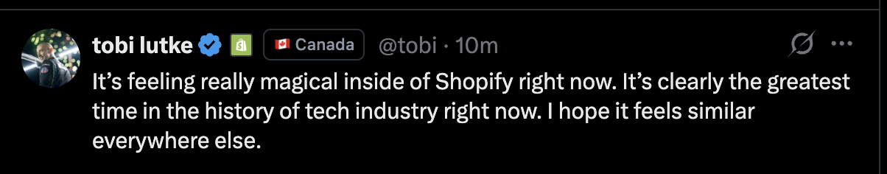
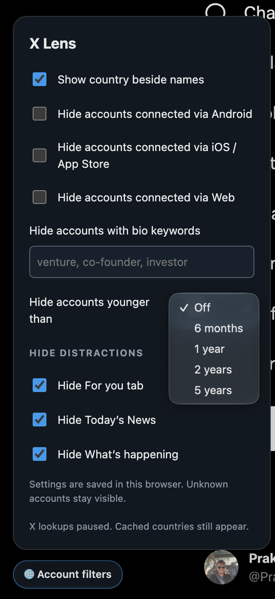

# X Lens

An extension for Chrome and Safari that shows the country of each X account beside its name, and hides the posts and page sections you do not want to see.

## What it does

- **Shows the country.** A flag and country name appear beside names in posts, replies, and quotes. The data comes from X's **About this account** page.
- **Hides accounts by connection.** Hide accounts that X reports as connected via Android, iOS / App Store, or Web.
- **Hides accounts by bio keyword.** Enter words or phrases with commas between them, for example `venture, co-founder, investor`.
- **Hides accounts by country.** Enter countries or regions with commas between them, for example `United States, South Asia`. The match ignores case, spaces, and hyphens.
- **Shows only the countries you select.** Enter a second list to hide accounts based in all other countries or regions.
- **Hides new accounts.** Hide accounts younger than 6 months, 1 year, 2 years, or 5 years.
- **Hides distractions.** Remove the **For you** tab, **Today's News**, and **What's happening**.

Each hidden post has a **Show post** button. Accounts with unknown details stay visible. Settings are saved in your browser.

## Add it to Chrome

X Lens is not in the Chrome Web Store. Load it as an unpacked extension. You need Chrome 111 or later on a desktop computer.

1. [Download the ZIP](https://github.com/prakash09/x-lens/archive/refs/heads/main.zip) and extract it to a folder that you will keep.
2. Open `chrome://extensions` in Chrome.
3. Turn on **Developer mode** in the top right corner.
4. Click **Load unpacked** and select the extracted folder. This is the folder that contains `manifest.json`.
5. Open [x.com](https://x.com/home) and refresh the page. Click **Account filters** at the bottom left to change the settings.

To update, replace the files in the folder with a new download. Then click the reload icon on X Lens in `chrome://extensions`.

## Add it to Safari on Mac and iPhone

X Lens is not in the App Store. Build it with Xcode on a Mac. You need Safari 18 or later on a Mac, or iOS 18 or later on an iPhone or iPad.

1. Download and extract the ZIP as shown above. Open `safari/X Lens/X Lens.xcodeproj` in Xcode.
2. Select each of the four targets, open **Signing & Capabilities**, and select your team.
3. **Mac:** select the **X Lens (macOS)** scheme and click **Run**. Then open **Safari > Settings > Extensions** and turn on **X Lens**.
4. **iPhone:** connect the iPhone, select the **X Lens (iOS)** scheme and your iPhone, and click **Run**. Then open **Settings > Apps > Safari > Extensions > X Lens** and turn on **Allow Extension**.
5. Open [x.com](https://x.com/home) in Safari. When Safari asks, select **Always Allow on This Website**. Tap or click **Account filters** at the bottom left to change the settings.

If Xcode reports that the bundle identifier is not available, change `com.prakash09.xlens` to your own identifier in each target. With a free Apple account, the iPhone app stops after 7 days. Run it from Xcode again to renew it.

## License

[MIT](LICENSE). X Lens is an independent project. It has no affiliation with X Corp.
